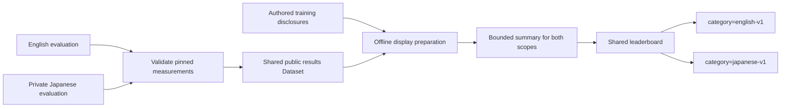

# English and Japanese evaluation scopes

S1MB combines independent English and Japanese evaluation scopes. English v1
retains its existing active manifest. Japanese v1 replaces the retired S1MB
Japanese experiments with the 27 Japanese benchmarks (8,067 judgments).
Uncertainty benchmarks are excluded. Source IDs, question order, soft targets,
numeric scales, compact provenance and upstream licenses remain unchanged.

## Preparation flow



Evaluation results retain their own source pins. Language membership and aggregate
eligibility come from the active definitions, while training exposure only adds
provenance UI. Japanese publication requires measurements evaluated against
`hotchpotch/S1MB-japanese-v1`. Rerun models whose only Japanese measurements
reference other benchmark releases; preserve those originals in private archives.

## Dataset repositories and provenance

- English: `hotchpotch/S1MB-english-v1` (existing public release, renamed from
  `hotchpotch/s1mb-dataset`). Old-name API and pinned file redirects were verified.
  Historical result repo IDs and SHA values must remain unchanged.
- Japanese: `hotchpotch/S1MB-japanese-v1` (private). Imported byte-for-byte from
  the pinned private source release recorded in its Dataset manifests.
  Historical measurements from other benchmark releases remain in private archives
  with their original source and revision; reevaluate them with S1MB for publication.

Installations have separate source receipts. Each result records the source that
owns its subset, including when both languages use one adapter and run ID. Private
Japanese evaluation rows and targets remain private. English and Japanese
measurements share `hotchpotch/s1mb-result`; the offline publisher prepares both
scopes for the same leaderboard. Browser runtime only loads the prepared bounded
summary; it never accesses training/evaluation rows. Public measurements retain
private Dataset references and exact SHAs without redistributing their contents.

## Run one or both languages

```sh
s1mb run --category english-v1 --adapter ADAPTER --model MODEL
s1mb run --category japanese-v1 --adapter ADAPTER --model MODEL
s1mb run --all --adapter ADAPTER --model MODEL
```

`--all` and `--category` are mutually exclusive. `--all` installs/checks both
sources once under the dataset lock and evaluates their union with one adapter.
Task, benchmark and limit filters still apply; limited runs remain partial.
`--offline-dataset` explicitly skips online checks for both installed sources.
This command does not mean every model supports Japanese: inspect GPU availability,
use physical GPU 1 on the shared workspace, reject overflow, and smoke-check Noul,
Choice and Score before a full run. Use fresh run IDs for reevaluations and
preserve original local measurements.

```sh
s1mb check-data --category english-v1
s1mb check-data --category japanese-v1
```

The home page switches language with `?category=english-v1` or
`?category=japanese-v1`. Switching clears benchmark/detail/comparison selections
so results from another language cannot leak into the selected scope. Models with
only one language remain valid contributions; absent coverage is not fabricated.

## Scores and source partitions

Both language scopes use S1MB Task Avg: average baseline-adjusted benchmark
scores within each task, then weight Noul, Choice and Score equally. Borda
ordering is computed within the selected language. Complete measured coverage
is required for an aggregate. Raw metrics remain visible.

Japanese uses `task-definitions-only-v1`: benchmark-specific system prompts are
empty; labels/provenance/solving hints never enter inference text. Preserve JMMLU's
unspecified original split, SOBACO's original train, JCoLA's original validation,
JSeM's unpartitioned suite and adopted NanoJMTEB wrapper queries. Do not describe
these as original-author held-out test. JMMLU and SOBACO use cap300. Generalization
synthetic sets retain CC BY-NC 4.0, maintainer-declared OpenAI GPT-6.1-Sol origin and
separate applicable OpenAI terms. Preserve source-specific retrieval conditions.

## Training exposure

See [training exposure](training_exposure.md). Missing disclosure means unknown,
not an unseen domain. **Known domain** denotes disclosed source-family or
related-domain training, without establishing use of S1MB evaluation examples or
an independent record-level overlap audit. Exact training revisions and splits may
be undisclosed; consult each entry's evidence and limitations. Actual evaluation-example
use is labeled separately as **Evaluation examples used**. The Bekko v0 training manifest at
`9c673a09c31e145684ab9915871afa72ba40a383` intersects 77 English source subsets,
covering 98 benchmark definitions. `evaluator/model-training-exposure.json` contains a
bounded authored disclosure for exactly the three current Bekko v0 model IDs.
Offline conversion and result export use it when metadata has no disclosure;
explicit per-model metadata takes precedence. This is manifest evidence, not a
record-level overlap audit or proof every available row was sampled. New model
versions must disclose their actual pinned training revision and filtering.

Saihai 8B retains its ten Japanese source-family disclosures and evaluated
Transformers BF16 release. JSICK NLI training and JSICK STS evaluation share a
source family but differ in task. No quantized Saihai rows are introduced.

English or Japanese PRs and result submissions are welcome.

## Shared results and leaderboard updates

English and Japanese measurements use the public `hotchpotch/s1mb-result`
Dataset. Each canonical model folder contains `metadata.json` and per-benchmark
`.json.xz` files for either language or both. Preserve each measurement's original
run ID, evaluator version, model revision, Dataset repo ID and exact SHA. Do not
rename benchmark IDs or rewrite recorded provenance.

Historical measurements referencing other benchmark releases have been withdrawn
from the shared Dataset. Reevaluate those models against
`hotchpotch/S1MB-japanese-v1` before submission. The original measurement repositories remain private archives.
Do not publish these archives or the private source release.
Submit new measurements to `hotchpotch/s1mb-result`.
Map a model to its canonical public folder, retain existing English measurements,
and disclose any language-specific inference settings. Model display metadata is
shared; measurement provenance and effective settings remain per benchmark.
Do not create a second row solely for a different parameter-counting method.

After exporting, validating and merging a results Dataset PR, prepare and publish
both scopes from the same pinned results snapshot. Run from `evaluator/`:

```sh
uv run python ../viewer/scripts/publish-display.py
# Review viewer/display/viewer-summary.json.report.json, then publish:
uv run python ../viewer/scripts/publish-display.py --publish
```

The publisher includes all active English and Japanese measurements, checks the
source inventory, compares against the previous public summary, and uploads only
`viewer-summary.json` with a parent-SHA guard. Reductions require explicit human
approval of the reported digest. Rebuild/redeploy the Space to load the new
summary; updating the Dataset alone does not refresh a running leaderboard.
Follow [the deployment runbook](huggingface_space_deploy.md#prepare-and-publish-display-data).

For a local viewer, synchronize the shared Dataset and prepare display data:

```sh
# From evaluator/; Japanese prediction validation requires authorized Dataset access.
uv run s1mb sync-results --repo-id hotchpotch/s1mb-result
# From viewer/:
npm run prepare-display -- --results-dir ../evaluator/data/hub-results
npm start
```

Restart the viewer after preparation. A public viewer build needs only the
prepared summary and never downloads private evaluation data. Training disclosures
and parameter annotations do not rewrite measurements or their model revisions.
